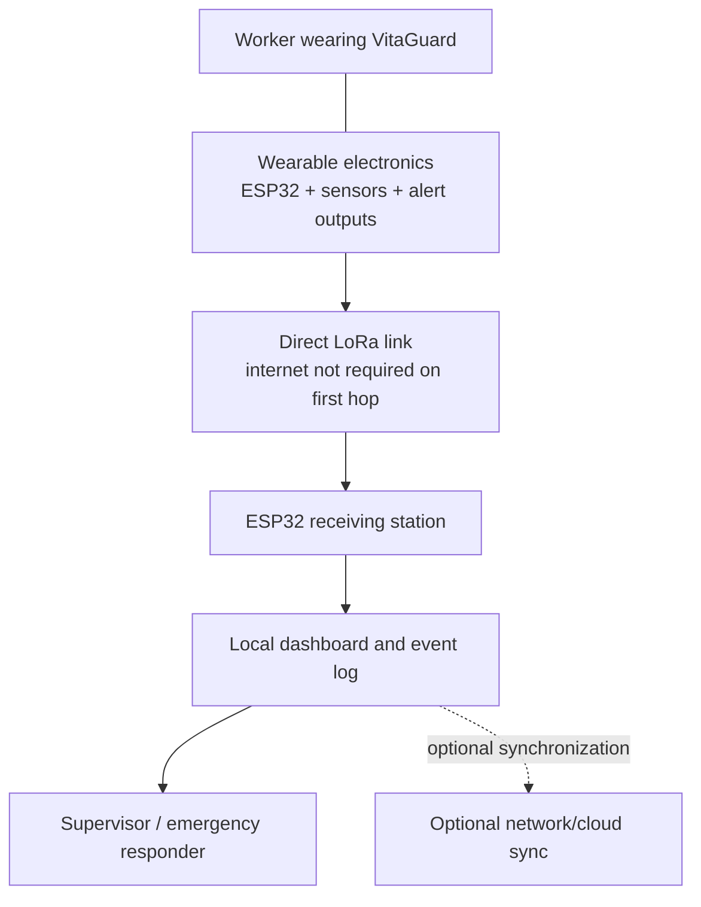

# System Architecture

## 1. Architectural overview

VitaGuard 2.0 is organized into six cooperating layers:

1. **Sensing layer:** optical physiological sensing, contact temperature, ambient temperature/pressure, gas-responsive sensing, acceleration and location where configured.
2. **Acquisition and validity layer:** sensor initialization, scheduled sampling, freshness checks, signal-quality flags, range checks and fault reporting.
3. **Intelligence layer:** physiological/thermal analysis, gas-risk analysis, movement/fall classification, worker-specific baseline comparison and meta-decision fusion.
4. **Response layer:** local haptic, audible and visual indications; event latching; SOS prioritization; event-history capture.
5. **Communication layer:** direct LoRa link plus configured BLE/GSM paths and local storage/synchronization.
6. **Presentation layer:** base-station reception, parsing, worker state tracking, alarm presentation, event history and individual/organizational reports.

## 2. System context

## 3. Edge decision path

Measurements should carry quality metadata. The risk engine should not treat an invalid value as a normal reading. Each domain output should include the source measurement, timestamp, validity/confidence indicator and decision reason, to the extent that the release implementation supports them.

The meta-decision stage combines domain results and assigns a worker state and a numerical risk score. A high-severity manual SOS is a separate event path: it should not have to wait for an AI score to cross a threshold.

## 4. Resilience

Core local functions include sensor sampling, risk evaluation and local alerts. The primary wearable-to-base station radio link can function without an internet connection. Additional BLE, cellular/SMS, local storage and synchronization functions depend on which modules and services are configured and available.

“Off-grid” does not mean that radio delivery is guaranteed in all underground, metal-shielded or obstructed environments. Actual range and packet delivery must be measured at the intended site.

## 5. Suggested figure set

- FIG. 1 — Overall system context.
- FIG. 2 — Wearable sensing/controller/alert block diagram.
- FIG. 3 — Risk assessment and event state machine.
- FIG. 4 — Emergency message sequence.
- FIG. 5 — Base-station receiver and dashboard sequence.
- FIG. 6 — Enclosure and sensor mounting.
- FIG. 7 — Data and 60-second incident history path.
